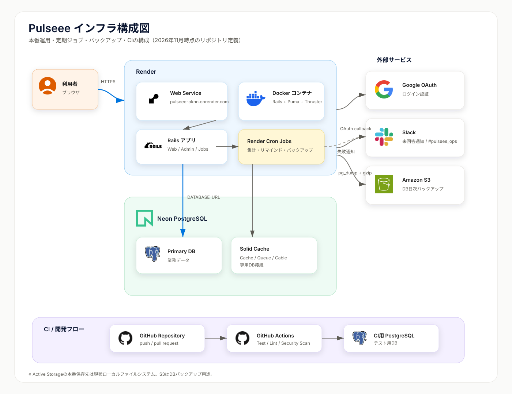
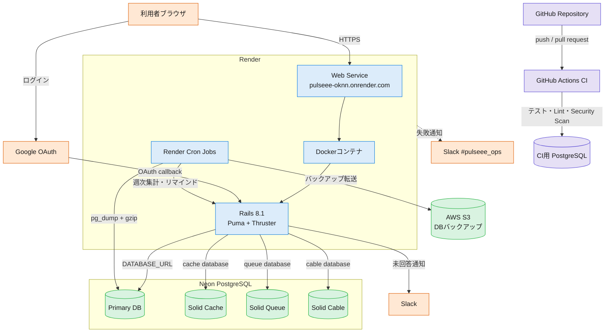

# インフラ構成図

Pulseeeの本番運用、定期ジョブ、バックアップ、CIの構成を示す。

SVGが表示できない環境では、以下のMermaid版を参照する。

## コンポーネント別の役割

### 全体像

この構成は、次の4つの層に分けて考えると理解しやすい。

1. **実行基盤**: Render、Docker
2. **アプリケーション**: Rails、Puma、Thruster
3. **データ・非同期処理**: Neon PostgreSQL、Solid Cache、Solid Queue、Solid Cable
4. **外部連携・運用**: Google OAuth、Slack、AWS S3、GitHub Actions

重要なのは、**Renderがアプリケーションそのものではなく、アプリケーションをインターネット上で動かすための実行基盤**だという点である。Railsは業務ロジックを実装するアプリケーション、PumaがHTTPリクエストを受け付けるアプリケーションサーバーである。

| コンポーネント | 分類 | 役割 | Pulseeeでの実体・担当 |
| --- | --- | --- | --- |
| Render | PaaS／実行基盤 | コードをビルドし、コンテナを起動・監視し、公開URLとログを提供する | `pulseee-oknn.onrender.com` のWeb Serviceを提供する。Web ServiceはHTTPリクエストを受ける常駐プロセスとして動く |
| Render Web Service | 公開Web実行環境 | インターネットからのHTTP/HTTPS通信をアプリへ転送する | 利用者のブラウザからのアクセスをDockerコンテナ内のRailsへ渡す。Render側でTLS終端が行われる |
| Render Cron Job | 定期実行基盤 | 指定したスケジュールでコマンドを起動し、処理終了後に停止する | 週次集計、未回答者リマインド、DBバックアップを実行する。Webリクエストを処理するWeb Serviceとは別の実行単位 |
| Docker | 実行環境のパッケージ | Ruby、OSライブラリ、Gem、アプリコード、起動コマンドを一つのイメージにまとめる | `Dockerfile` で本番用イメージを作り、Render Web ServiceとCron Jobから利用できる状態にする |
| Railsアプリ | アプリケーション | 認証、画面表示、サーベイ、回答保存、管理画面、外部サービス連携などの業務ロジックを担当する | `app/`、`config/`、`db/` などのプロジェクト本体。Rails自体はフレームワークであり、単独でHTTPポートを待ち受ける役割ではない |
| Puma | アプリケーションサーバー | RailsアプリをRubyプロセスとして起動し、HTTPリクエストをRailsへ渡す | `bin/rails server` の実行基盤。Dockerの起動コマンドでThrusterから呼び出される |
| Thruster | HTTP補助プロキシ | Pumaの前段で静的アセット配信やHTTP処理を補助する | Dockerの `CMD` で `./bin/thrust ./bin/rails server` として起動する |
| Neon PostgreSQL | マネージドデータベース | PostgreSQLをクラウドで運用し、データの永続保存と接続先を提供する | `DATABASE_URL` でRailsから接続する本番DB。ユーザー、サーベイ、回答、権限などを保存する |
| PostgreSQL Primary DB | 業務データ | アプリケーションの正規データを保存する | `users`、`surveys`、`survey_assignments`、`score_answers` などを保存する |
| Solid Cache | Railsキャッシュ | ページ断片や計算結果など、再生成可能なデータをDBに保存する | `config.cache_store = :solid_cache_store`。本番ではPostgreSQLの `cache` 接続を使う |
| Solid Queue | Railsジョブキュー | すぐに実行せず、後で実行するジョブをDBに登録・管理する | Slack通知、サーベイ作成、週次集計などのActive Jobを管理する。`queue` 接続を使う |
| Solid Cable | Action Cableバックエンド | WebSocket／Action Cableのメッセージを保持・配信する | 本番のAction Cableで使用し、PostgreSQLの `cable` 接続を使う |
| Google OAuth | 認証プロバイダー | Googleアカウントによる本人確認を行い、認証結果をRailsへ返す | `GOOGLE_CLIENT_ID`、`GOOGLE_CLIENT_SECRET` を使う。コールバック後、メールアドレスを事前登録ユーザーと照合する |
| Slack | 通知先サービス | アプリケーションから通知を受け取り、チャンネルへ投稿する | `SLACK_SURVEY_WEBHOOK_URL` による未回答者通知。Render Cronの失敗通知は `#pulseee_ops` へ送る運用 |
| AWS S3 | オブジェクトストレージ | ファイルをオブジェクトとして長期保存する | `bin/backup_database_to_s3` が `pg_dump` の圧縮ファイルを日次保存する。Active Storageの保存先としてではなく、DBバックアップ用途で使う |
| GitHub Actions | CI実行基盤 | push／Pull Requestを契機にテスト、Lint、脆弱性スキャンを実行する | `.github/workflows/ci.yml` に定義。CI内で一時的なPostgreSQLサービスを起動してRSpecを実行する |

## 処理の流れ

### 1. 利用者が画面を開く場合

1. 利用者のブラウザが `https://pulseee-oknn.onrender.com` にHTTPSアクセスする。
2. Render Web Serviceが通信を受け、Dockerコンテナへ転送する。
3. コンテナ内のThrusterがHTTP処理を受け、Pumaへ渡す。
4. PumaがRailsアプリを呼び出す。
5. RailsがNeon PostgreSQLからユーザー、サーベイ、回答状況などを読み込む。
6. RailsがHTMLを生成し、Puma、Thruster、Renderを経由してブラウザへ返す。

### 2. Googleログインの場合

1. RailsがGoogle OAuthへのログイン導線を表示する。
2. ブラウザがGoogleで認証する。
3. GoogleがOAuth callback URLへ認証結果を返す。
4. RailsがGoogleから受け取ったメールアドレスを、Neon PostgreSQLの事前登録ユーザーと照合する。
5. 一致した場合だけRailsのログインセッションを作成する。

### 3. 定期処理の場合

Render Cron Jobは、Web Serviceの中で常時動くデーモンではなく、スケジュール時刻に独立して起動する実行単位である。Cron Jobが同じコードと環境変数を使ってRailsのタスクまたはジョブを実行し、Neon PostgreSQLを読み書きする。

- 木曜日18:00: 未回答者を検索し、Slackへリマインドを送る
- 週次: チーム別スコアを集計する
- 毎日: `pg_dump` でDB全体をバックアップし、gzip圧縮してS3へ保存する

### 4. 非同期ジョブの場合

Railsが処理をその場で完了させずにジョブを登録すると、Solid QueueがPostgreSQLのキュー用テーブルへ保存する。ワーカーがジョブを取り出して実行し、例えばSlack通知を外部Webhookへ送信する。ジョブの実行状態もPostgreSQLで管理される。

### 5. デプロイとCIの場合

1. GitHubへpushまたはPull Requestを作成する。
2. GitHub Actionsがテスト、RuboCop、Brakeman、bundler-audit、Importmap監査を実行する。
3. Render Web Service側では、連携ブランチのコードからDockerイメージをビルドする。
4. 新しいコンテナを起動し、Railsアプリを本番環境へ反映する。

## RenderとRailsの違い

| 用語 | 何を指すか | 例えるなら |
| --- | --- | --- |
| Render | アプリを動かすクラウド基盤、デプロイ、公開URL、ログ、Cronを提供するサービス | 土地・建物・電源・運用設備 |
| Docker | 実行に必要なものをまとめたイメージと、その実行単位 | 店舗を丸ごと梱包したコンテナ |
| Rails | HTTPリクエストに対する業務処理を実装したアプリケーション | 店舗の業務・接客ロジック |
| Puma | Railsアプリを起動してHTTPを受け付けるサーバー | 店舗の受付窓口 |
| Neon PostgreSQL | データを永続保存する外部データベース | 台帳・在庫庫 |

RenderのWeb Serviceは、Railsアプリを動かすための「場所と運用」を担当する。Railsアプリが「何を返すか」を担当し、PumaがRailsをHTTPサーバーとして動かす。

## 補足

- 本番アプリケーションはRender上のDockerコンテナで稼働する。
- Rails本体、Solid Cache、Solid Queue、Solid Cableは、Neon PostgreSQLの接続を利用する。
- Render Cronは、週次集計、未回答者リマインド、DBバックアップを実行する。
- DBバックアップは`pg_dump`で取得し、圧縮してAWS S3へ保存する。
- Render Cronの失敗は、運用通知としてSlackの`#pulseee_ops`へ通知する。
- GitHub Actions CIでは、CI用PostgreSQLを使ってテストを実行する。
- Active Storageの本番保存先は現状ローカルファイルシステム設定であり、図の外部S3はDBバックアップ用途である。
